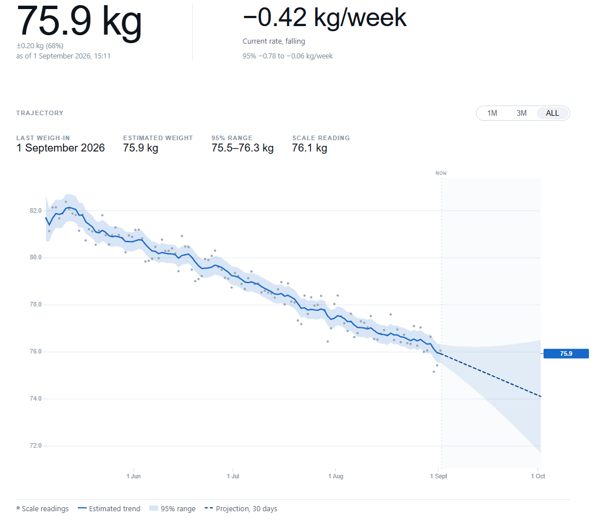
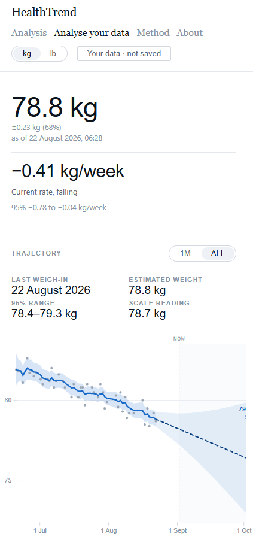
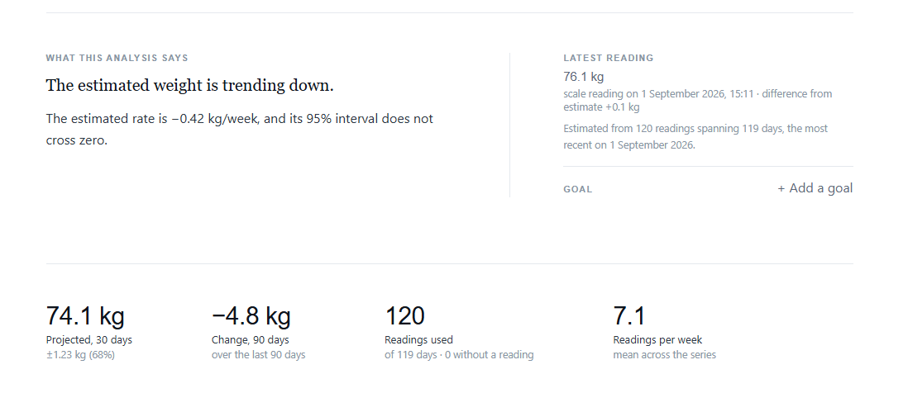
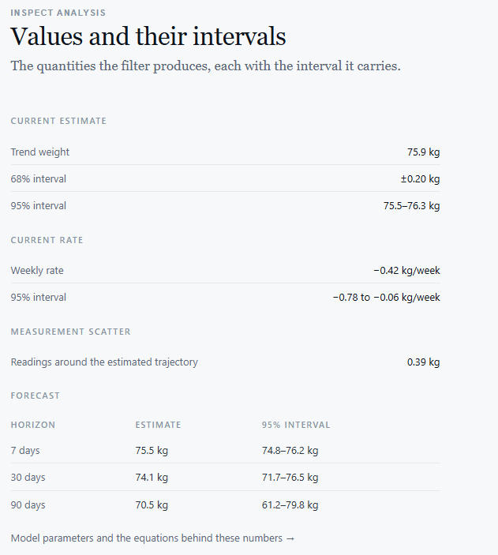
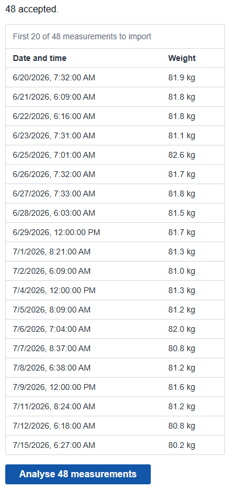

# HealthTrend

**Understand the trend behind your weight — not just the number on the scale.**

HealthTrend is a live, open-source application for tracking body weight and estimating its underlying trajectory from noisy, irregular weigh-ins. It combines a probabilistic state-space model with uncertainty-aware forecasts, a persistent personal history, and optional Apple Health import and ongoing sync.

**[Open HealthTrend](https://healthtrend.alfredhong.com/app)** · **[Try the interactive demo](https://healthtrend.alfredhong.com/v2/gradual-loss)** · **[Read the method](https://healthtrend.alfredhong.com/v2/method)**



*Interactive demo with synthetic measurements. No real person's health data is shown.*

## What you can do

- **Track your weight over time.** Sign in with a one-time email code, log readings in kg or lb, edit your history, or import a CSV.
- **See the underlying trend.** A Kalman-filter-based estimator separates short-term fluctuations from an estimated weight trajectory and current weekly rate of change.
- **Understand uncertainty.** View intervals around the estimated weight, rate and 7-, 30- and 90-day forecasts, rather than treating any one prediction as certain.
- **Connect Apple Health.** Use iPhone Shortcuts to import up to three years of Weight samples once, then sync the most recent 14 days on a schedule. The connection uses a dedicated, revocable token; no native iOS app is required.
- **Keep control of your data.** Export your measurements as CSV or your account data as JSON, and delete your account and its stored data.
- **Explore without signing in.** Try labelled synthetic scenarios or analyse a temporary dataset through the public analysis interface.

### Getting started

1. **Explore without an account.** [Try the interactive demo](https://healthtrend.alfredhong.com/v2/gradual-loss) or [analyse your own measurements temporarily](https://healthtrend.alfredhong.com/v2/analyse).
2. **Save your history.** [Open the app](https://healthtrend.alfredhong.com/app) and request a one-time email sign-in code. If new-account access is restricted, the public demo and analysis remain available without signing in.
3. Log a weigh-in, import a CSV, or follow **[Apple Health setup](https://healthtrend.alfredhong.com/app/connect/apple-health)**. It uses two iPhone Shortcuts: a one-time import of up to three years of Weight history and a separate 14-day recurring sync. The setup page explains where to paste the same revocable connection token into each Shortcut and how to schedule the latter.
4. Open **Trend** to see the estimated trajectory, rate and forecasts. Your optional goal is a display reference only; it never influences the estimate.


## Product walkthrough

The screenshots below show the public analysis and import experience using **synthetic data**, not anyone's private health records.

### Analyse your own measurements



*Analyse manually entered measurements or a CSV without saving them to an account. [Try the public analysis](https://healthtrend.alfredhong.com/v2/analyse).*

### Understand the evidence behind a trend



*The analysis separates the main conclusion from its explanation, supporting readings and detailed statistics.*

### Inspect uncertainty and forecasts



*The estimate, current rate and forecasts include model-derived uncertainty intervals.*

### Preview CSV imports



*CSV readings are validated and previewed before analysis. The repository includes a [synthetic sample CSV](sample_data/example.csv).*

## How it works

Each weigh-in is a noisy observation of body weight, not a direct measurement of its underlying trajectory. HealthTrend uses a **continuous-time Kalman filter** to estimate latent weight and its current rate of change, accounting for irregular gaps between readings. The model propagates uncertainty into weight and rate estimates and into **7-, 30- and 90-day forecasts**. Its parameters are documented rather than fitted to each user’s short history.

**[Read the full Method page](https://healthtrend.alfredhong.com/v2/method)** · **[See the evaluation, including where the model underperforms](docs/evaluation/report.md)**

## Evaluation and limitations

HealthTrend has a substantial reproducible **synthetic-data evaluation**, including independent numerical checks, calibration experiments, irregular sampling, parameter-identifiability studies and comparisons against simpler forecasting methods.

The results are deliberately mixed. Under the model's own assumptions, the reported 95% intervals achieved approximately nominal coverage in the tested synthetic settings (94.9% for both latent weight and velocity). However, a tuned Holt method outperformed the shipped estimator on the 30-day forecast metric in **6 of 8** tested synthetic regimes. Uncertainty coverage also deteriorated under certain model misspecifications.

The process-noise intensity (σₐ) was **not identifiable from one month of observations**, even when the number of weigh-ins increased tenfold. This is why HealthTrend retains **documented fixed priors** instead of fitting that parameter separately to each user's short history; it is *not* proof that the chosen priors are optimal.

**The application has not been clinically validated, and the evaluation does not establish predictive accuracy on real people.** It is not a medical device and does not diagnose, treat or recommend changes to health behaviour.

Read the **[full evaluation report](docs/evaluation/report.md)**, including negative findings and experimental limitations.

## Architecture

| Layer | Implementation |
| --- | --- |
| Web application | Next.js 16, React 19, TypeScript, CSS Modules, visx |
| API | FastAPI, Pydantic, Python, NumPy |
| Estimation | Deterministic state-space model and Kalman filter |
| Persistence | PostgreSQL, SQLAlchemy 2, psycopg 3, Alembic |
| Authentication | Passwordless email codes, secure HttpOnly session cookie |
| Apple Health | iPhone Shortcuts, source-specific revocable bearer credentials |
| Deployment | Vercel (web), Render (API), Neon (database), SMTP (email) |

### Engineering highlights

- **Enforced architecture.** AST-based tests enforce the `api → services → core` dependency direction. The deterministic numerical core has an explicit import allowlist and no framework, filesystem, clock or randomness dependencies.
- **Checked API contract.** The backend generates `backend/openapi.json`, from which the frontend TypeScript contract is generated. CI checks both generated artifacts for drift.
- **Independent numerical verification.** The Kalman filter was checked against a joint-Gaussian computation across an 810-case battery, with a **60-digit arithmetic check** for the worst ill-conditioned case. The evaluation records disagreements rather than counting them as passes.
- **Data-leakage tests.** Sentinel weight values are propagated through failure paths to test that errors and logs do not reveal submitted measurements. Frontend checks enforce an explicit, narrowly scoped browser-storage policy rather than claiming that no browser storage is ever used.
- **Automated validation.** The latest development runs passed **1,431 backend tests** and **530 frontend tests**, alongside linting, type-checking and a production frontend build.

The signed-in product stores account data and weight history in PostgreSQL. The separate public analysis flow processes a submitted dataset without adding it to an account. Apple Health integration reads **Weight only**, sends measurements to the account's API, and does not write back to Apple Health. Connection credentials are hashed server-side and can be revoked in Settings.

See **[architecture](docs/architecture.md)** and **[privacy](docs/privacy.md)** for details.

## Local development

**Backend** (Python and [`uv`](https://docs.astral.sh/uv/)):

```bash
cd backend
uv sync --locked
# Configure the local database, auth, mailer and CORS settings; see backend/.env.example.
uv run alembic upgrade head
uv run uvicorn app.main:app --no-access-log
```

**Frontend** (Node version in `frontend/.nvmrc`):

```bash
cd frontend
npm ci
# Configure the API origins; see frontend/.env.example.
npm run dev
```

The backend must have its documented environment variables configured **before** migration or startup. Local development can use SQLite and a console mailer; production uses PostgreSQL and SMTP. Do not commit `.env` files or personal health exports.

To run checks:

```bash
# From backend/
uv run pytest -q
uv run ruff check .
uv run mypy

# From frontend/
npm run typecheck
npm run lint
npm run test
npm run build
```

## Documentation

Browse the **[documentation index](docs/README.md)** for the model, evaluation, architecture, privacy controls, deployment and design decisions.

## Licence

MIT © 2026 Alfred Hong.
